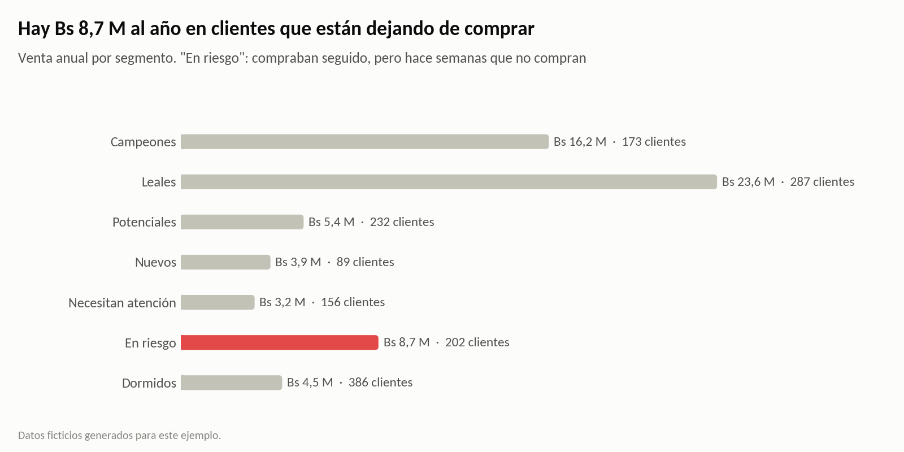
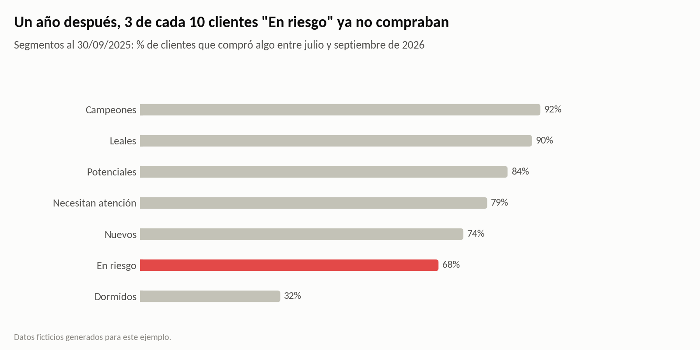
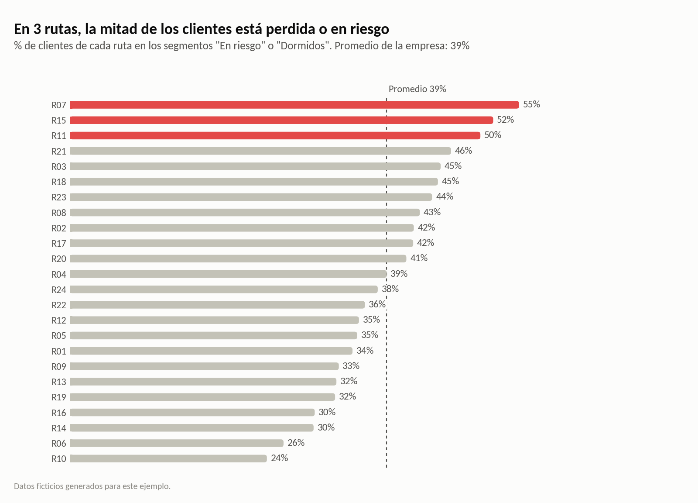
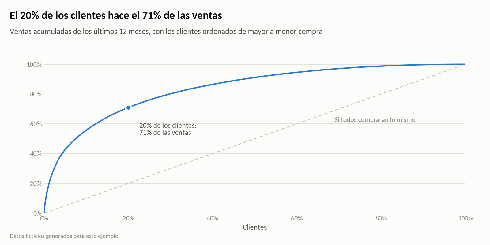
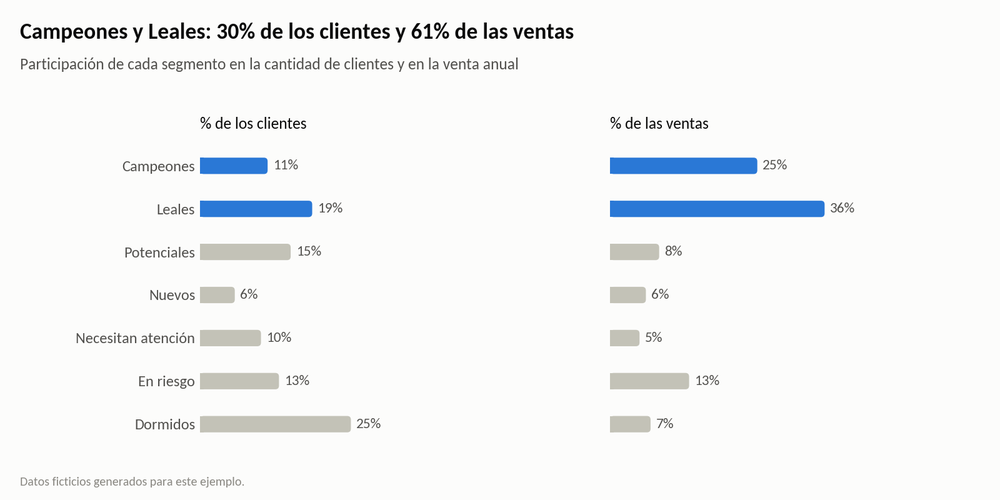
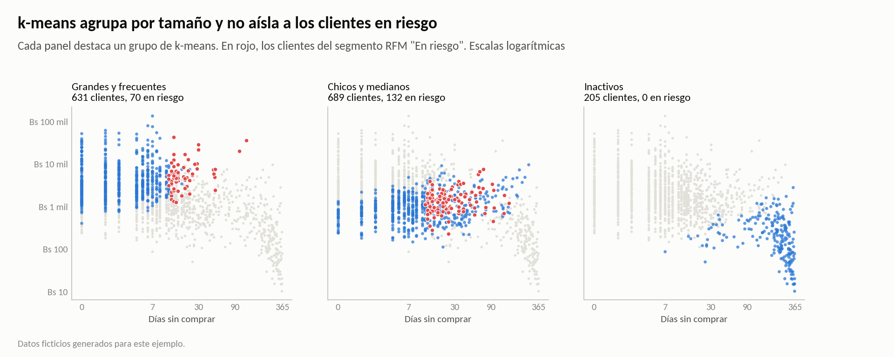

# ¿Qué clientes sostienen las ventas y cuánto se pierde si se van?

**Segmentación RFM de clientes con Python.** Clasifica a los clientes de una distribuidora de bebidas según cuándo compraron por última vez, qué tan seguido compran y cuánto compran. Después prueba con el año anterior si la segmentación anticipa quién deja de comprar y calcula cuánta plata está en juego.



> **Datos ficticios.** Corresponden a una distribuidora de Santa Cruz con unos 1.500 clientes activos (tiendas de barrio, kioscos, minimercados, restaurantes y mayoristas) y unos 100.000 pedidos entre octubre de 2024 y septiembre de 2026. Se generan con `generar_datos.py`. Los datos no dicen qué clientes dejaron de comprar: eso lo tiene que descubrir el análisis.

## Resultados

| Pregunta | Respuesta |
|---|---|
| ¿Quién sostiene las ventas? | El **20%** de los clientes hace el **71%** de las ventas. Campeones y Leales son el 30% de los clientes y el **61%** de las ventas. |
| ¿Quién se está yendo? | **202 clientes "En riesgo"**: compraban seguido, pero hace semanas que no compran. Juntos compran **Bs 8,7 millones** al año. |
| ¿La segmentación anticipa algo? | Sí. De los clientes que estaban "En riesgo" hace un año, **3 de cada 10** dejaron de comprar y sus compras cayeron **35%**. De los Campeones, el 92% siguió comprando. |
| ¿Cuánto está en juego? | Si se repite lo del año anterior, se pierden **unos Bs 3,0 millones** al año. Recuperar la mitad de esa caída vale **unos Bs 1,5 millones**. |
| ¿Qué hacer primero? | **Visitar a los 50 clientes en riesgo más grandes**, que son el 65% de esa venta. Y revisar en terreno las rutas **R07, R15 y R11**, donde la mitad de los clientes está perdida o en riesgo (el promedio es 39%). |

## Cómo se hizo

1. **Notas RFM.** Cada cliente recibe una nota del 1 al 5 por quintiles en tres variables:
   - **R:** días desde la última compra.
   - **F:** pedidos por mes.
   - **M:** compra mensual en Bs.

   F y M se miden por mes de relación, así un cliente que llegó a mitad de año no queda castigado.
2. **Segmentos.** Salen de R y F con reglas simples: Campeones, Leales, Potenciales, Nuevos, Necesitan atención, En riesgo y Dormidos. El monto sirve para priorizar dentro de cada segmento.
3. **Prueba con el año anterior.** Se segmenta a los clientes como estaban el 30/09/2025 y se mira qué hicieron en los 12 meses siguientes. Así se comprueba que la segmentación anticipa quién deja de comprar.
4. **Plata en juego.** La venta anual de los clientes en riesgo se multiplica por la caída que tuvieron los clientes en riesgo del año anterior.
5. **Rutas.** Se busca dónde se concentran los clientes perdidos o en riesgo.
6. **Contraste con k-means.** Un algoritmo sin reglas agrupa a los mismos clientes. Coincide con RFM en los extremos, pero reparte a los clientes en riesgo entre los grupos activos: agrupa por tamaño, no por riesgo. Para retener clientes sirven más las reglas RFM.





| | |
|---|---|
|  |  |



## Qué hacer con cada segmento

| Segmento | Objetivo | Acción sugerida |
|---|---|---|
| Campeones | Cuidarlos | Abastecimiento prioritario, sin quiebres de stock; visita del supervisor |
| Leales | Subir el ticket | Combos y lanzamientos; ofrecer las familias que todavía no compran |
| Potenciales | Subir la frecuencia | Día fijo de visita; promociones por volumen |
| Nuevos | Lograr la segunda y tercera compra | Seguimiento en las primeras semanas |
| Necesitan atención | Entender qué cambió | Preguntar en la próxima visita; revisar precios y surtido |
| En riesgo | Recuperarlos ya | Visita del supervisor a los más grandes primero; oferta de reactivación |
| Dormidos | Recuperar barato | Llamada o mensaje; no gastar visitas presenciales |

El archivo `resultados/clientes_segmentados.csv` trae el segmento, la acción y la prioridad de cada cliente. Está listo para pasarlo al equipo de ventas.

## Estructura

```
├── analisis_rfm.ipynb            análisis completo, con resultados y gráficos
├── generar_datos.py              genera los datos ficticios (semilla fija)
├── graficos.py                   estilo de los gráficos
├── requirements.txt
├── datos/
│   ├── clientes.csv              una fila por cliente: tipo, zona, ruta y fecha de alta
│   └── ventas.csv                una fila por pedido: fecha, cajas y monto
├── resultados/
│   └── clientes_segmentados.csv  segmento, notas RFM, acción y prioridad de cada cliente
└── img/                          gráficos del análisis
```

## Cómo correrlo

```bash
pip install -r requirements.txt
python generar_datos.py          # opcional: los datos ya están en datos/
jupyter notebook analisis_rfm.ipynb
```

## Límites

- La caída esperada supone que este año se repite lo que pasó el anterior. Sirve para dimensionar, no es un pronóstico.
- RFM mira solo cómo compra cada cliente, no por qué compra menos. La causa puede ser la competencia, un cambio de dueño o un problema de servicio: la visita sirve para averiguarlo.
- Las rutas con más clientes perdidos son una pista, no un diagnóstico. Hay que revisar en terreno la frecuencia de visita, los quiebres de stock y la atención.

**Herramientas:** Python · pandas · scikit-learn · matplotlib

---

### English summary

RFM customer segmentation for a fictional beverage distributor in Santa Cruz, Bolivia, with synthetic data on about 1,500 active retail customers and 100,000 orders from October 2024 to September 2026.
- Customers are scored on recency, frequency and monetary value, and grouped into seven segments with simple rules.
- A backtest on the previous year shows the segments anticipate churn: 3 in 10 "at risk" customers stopped buying and their purchases fell 35%. Applied to today's at-risk customers, that is about Bs 3.0 million a year.
- A k-means comparison shows that clustering groups customers by size rather than by churn risk, so the rule-based segments work better for retention.

---

Vicente Asbun · [LinkedIn](https://www.linkedin.com/in/vicente-antonio-asbun-karmy-30aa19164/)
